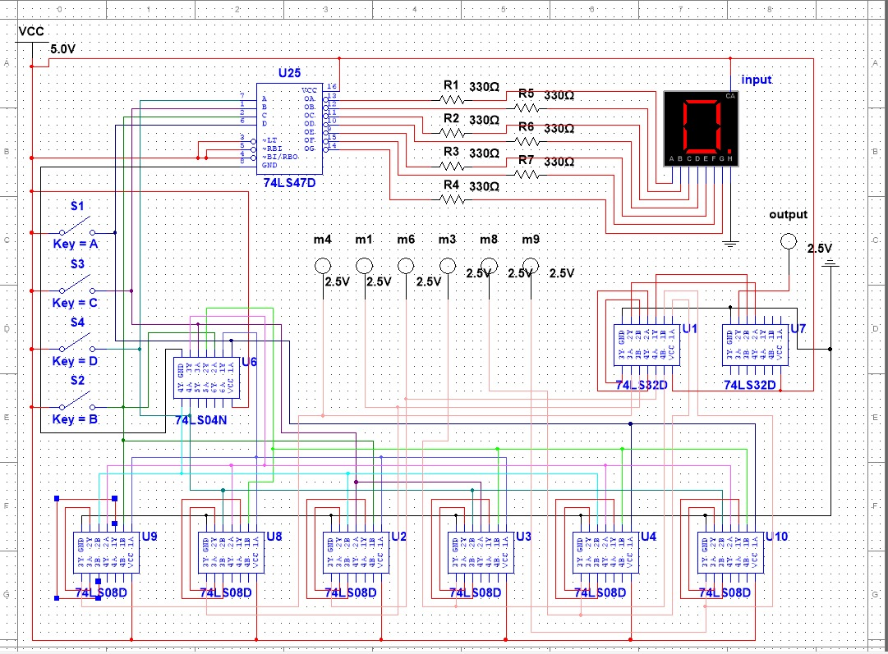
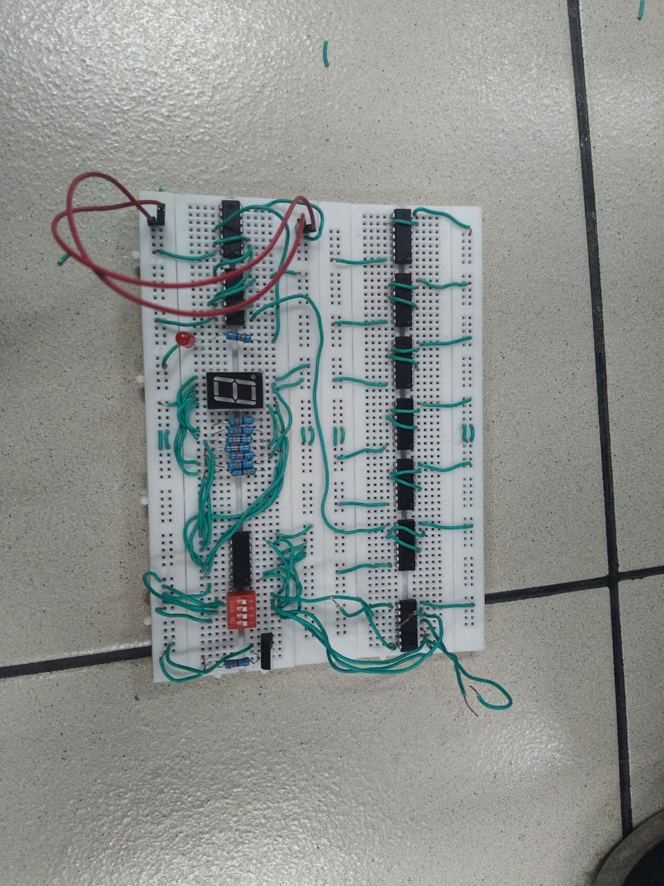

# Display-Seven-Segment-Gerbang-Logika-IC
Perakitan sirkuit perangkat keras logika digital untuk menerjemahkan sinyal masukan logika biner menjadi tampilan angka desimal pada penampil seven segment.

# Implementasi Fungsi Kanonis SOP Menggunakan Multiplexer 8-to-1 Diskrit dan Visualisasi Seven Segment
*(Proyek Akhir Semester Ganjil - Sistem Logika | Politeknik Elektronika Negeri Surabaya)*

## 📝 Deskripsi Proyek
Proyek akhir semester ini bertujuan merancang, mensimulasikan, dan merakit sistem logika kombinasional kompleks untuk mengeksekusi fungsi Boolean 4 variabel:
$$F(A,B,C,D) = \Sigma (1,3,4,6,8,9)$$

Realisasi sirkuit ini mengimplementasikan metode Multiplexer (MUX) 8-to-1 yang bertindak sebagai *Universal Logic Gate* untuk memangkas jumlah gerbang. Tiga variabel (A, B, C) dikonfigurasikan sebagai jalur *selector* (pemilih), sementara variabel D diintegrasikan sebagai data input bersama konstanta logika 0 dan 1.

## 📐 Arsitektur Sistem & Komponen Diskrit
Sirkuit ini dibangun di atas dual-breadboard matrix terintegrasi dengan spesifikasi komponen berikut:
- **Core Pemrosesan MUX:** 1x IC 74LS04 (NOT), 6x IC 74LS08 (AND), dan 2x IC 74LS32 (OR).
- **Sektor Visualisasi Input:** 4-bit Dip Switch sebagai toggle input, dihubungkan ke IC BCD-to-7 Segment Decoder (74LS47) untuk menampilkan angka heksadesimal (0-9, A-F) secara visual pada Seven Segment Anoda.
- **Sektor Visualisasi Output:** 1x Indikator LED merah untuk memantau status logika HIGH (1) atau LOW (0).
- **Manajemen Daya:** Sumber daya Baterai 9V DC yang diturunkan secara konstan ke level aman 5V DC menggunakan IC Regulator Tegangan LM7805.
- **Anggaran Finansial:** Total biaya pengadaan komponen perakitan fisik adalah Rp 130.200,-.

## 📊 Tabel Kebenaran Fungsi Terverifikasi
Berdasarkan hasil pengujian laboratorium, output LED terbukti 100% akurat menyala (HIGH) hanya pada kombinasi input baris minterm berikut:
- Baris 1: (0001) -> OUTPUT = 1
- Baris 3: (0011) -> OUTPUT = 1
- Baris 4: (0100) -> OUTPUT = 1
- Baris 6: (0110) -> OUTPUT = 1
- Baris 8: (1000) -> OUTPUT = 1
- Baris 9: (1001) -> OUTPUT = 1

## 📷 Dokumentasi Sistem

### 1. Skema Perancangan Logika Digital (NI Multisim)

### 2. Implementasi Wiring Fisik Komponen Diskrit (Hardware)

## 📺 Video Demonstrasi Pengujian Alat
Pembuktian fungsional sikit saat menerima kombinasi input sakelar dan menampilkan angka desimal real-time pada 7-segment serta nyala LED dapat diakses di sini:
👉 [Tonton Video Pengujian Fisik Seven Segment](TEMPELKAN_LINK_GOOGLE_DRIVE_ANDA_DI_SINI)

*File mentah simulasi sirkuit (project_sislog - Copy (2) - Copy.ms14) tersedia di dalam repositori ini untuk pengujian interaktif langsung.*
